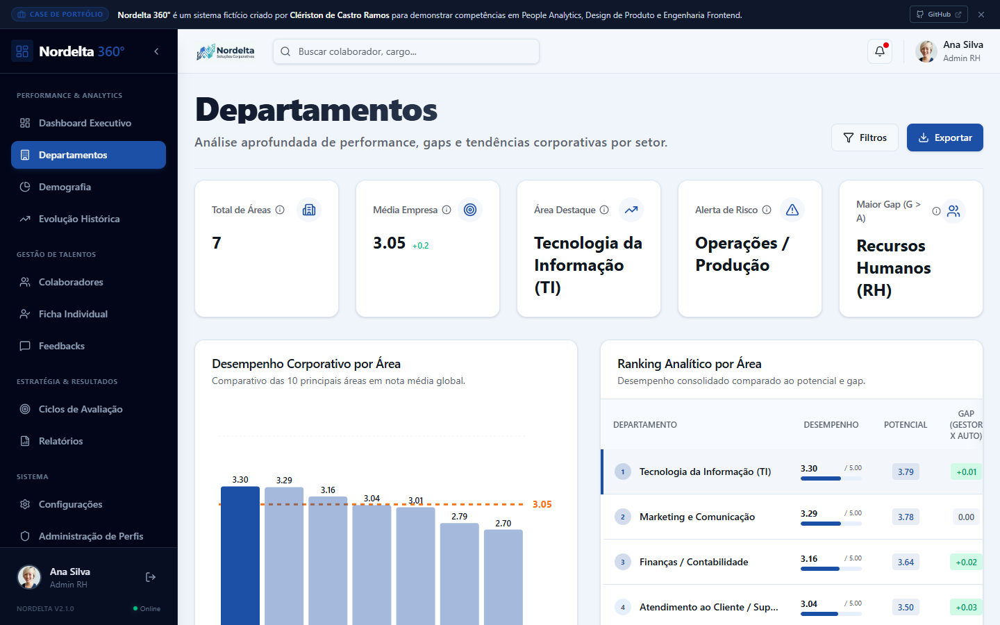
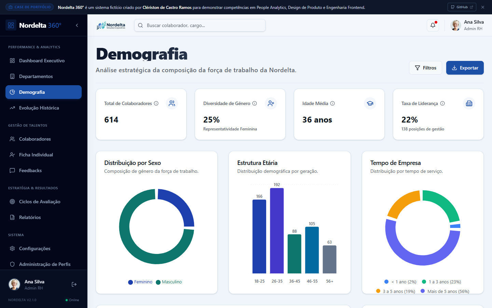

<div align="center">


# Nordelta 360°

**Sistema Corporativo de Avaliação 360° e People Analytics**

Um dashboard executivo avançado para análise de performance, simulação de feedbacks e desenvolvimento de talentos corporativos.

_⚠️ Aviso: Este é um **projeto fictício** construído como case oficial para portfólio de engenharia de software e design de produto._

</div>

---

## 📸 Demonstração Visual

|                       **Dashboard Executivo**                        |                             **Ficha Individual**                              |
| :------------------------------------------------------------------: | :---------------------------------------------------------------------------: |
|  |       |
| Visão geral de performance, competências e ranking por departamento. | Radar 360°, forças, pontos de desenvolvimento e plano de ação do colaborador. |

|                             **Departamentos**                             |                                 **Demografia**                                  |
| :-----------------------------------------------------------------------: | :-----------------------------------------------------------------------------: |
|         |                     |
| Comparativo entre áreas, ranking analítico e gaps gestor x autoavaliação. | Composição da força de trabalho por gênero, idade, tempo de casa e localização. |

|                            **Evolução Histórica**                            |                        **Ciclos de Avaliação**                        |
| :--------------------------------------------------------------------------: | :-------------------------------------------------------------------: |
|  |      |
|     Tendência da nota média entre ciclos e leitura executiva automática.     | Criação, acompanhamento e encerramento das rodadas de avaliação 360°. |

---

## 🎯 Sobre o Projeto

O **Nordelta 360°** simula a operação interna da "Nordelta Soluções Corporativas", uma empresa de fachada para fins deste case. O sistema foi desenvolvido para atuar como uma plataforma robusta de **People Analytics e Avaliação 360°**, modelando o fluxo de dados típico de um setor de Recursos Humanos de alta maturidade analítica.

O objetivo principal deste repositório é servir como uma **prova de conceito (PoC) para o meu portfólio**, atestando competências sólidas em:

- Desenvolvimento e engenharia de interfaces web (B2B).
- Arquitetura de aplicações front-end modernas.
- Estruturação e visualização de grandes volumes de dados (Data Visualization).
- UX/UI aplicados a dashboards corporativos e alta densidade de informação.
- Domínio do ciclo de vida e engenharia de software voltados para produto.

---

## 🚀 Funcionalidades

O sistema conta com um ecossistema focado na avaliação e retenção de talentos:

- **📊 Dashboard Executivo:** Visão macro da empresa com indicadores de performance e engajamento.
- **👤 Ficha Individual Premium:** Perfil consolidado de cada colaborador.
- **🎯 Visualização de Dados (Data Viz):** Gráficos de radar para soft/hard skills, histogramas de distribuição, heatmaps e rankings setoriais.
- **👥 Diretório de Talentos:** Listagem interativa e filtro multidimensional de profissionais.
- **📈 Evolução Histórica:** Acompanhamento do progresso de colaboradores através de métricas comparativas em ciclos anteriores.
- **⚙️ Administração de Ciclos 360°:** Criação, andamento e finalização de ciclos de avaliação.
- **💬 Feedbacks e Calibragem:** Painel para leitura e calibração de avaliações (pares, gestores, autoavaliação).

---

## 🛠 Tecnologias Utilizadas

Este projeto foi construído empregando tecnologias estabelecidas no ecossistema front-end para garantir performance e escalabilidade:

- **[React](https://react.dev/)** + **[TypeScript](https://www.typescriptlang.org/)**: Base de UI robusta e estaticamente tipada.
- **[Tailwind CSS](https://tailwindcss.com/)**: Estilização utilitária e responsiva.
- **[TanStack Router](https://tanstack.com/router/latest)**: Roteamento modular com segurança de tipos (type-safe).
- **[TanStack Query](https://tanstack.com/query/latest)**: Cache das consultas entre páginas.
- **[Supabase](https://supabase.com/)**: Banco Postgres com Row Level Security que armazena colaboradores e avaliações.
- **[Recharts](https://recharts.org/)**: Motor de composição para os componentes de gráficos.
- **[shadcn/ui](https://ui.shadcn.com/)**: Primitivas de interface acessíveis e customizáveis.
- **Vite**: Ferramenta de build extremamente rápida.

---

## 🏗 Arquitetura e Dados

O design arquitetural do Nordelta 360° foca em modularização e performance de renderização:

- **Dados Sintéticos no Supabase:** Colaboradores, avaliações e departamentos são fictícios e ficam em um banco Postgres no Supabase (schema e políticas de acesso em `supabase/migrations`). Os CSVs de origem estão em `data/`.
- **Camada de dados:** `src/lib/db.ts` concentra as consultas ao Supabase; `src/lib/data-service.ts` transforma os dados em métricas (médias, gaps, percentis, rankings); as páginas consomem tudo via TanStack Query (`src/lib/queries.ts`), com cache entre navegações.
- **Simulação de avaliadores:** As notas por grupo de avaliador (gestor, autoavaliação, pares e subordinados) são derivadas de forma determinística da nota de cada competência, então os números não mudam entre recarregamentos.
- **Code splitting:** Cada rota é carregada sob demanda, e as bibliotecas de PDF só são baixadas quando o usuário exporta um relatório.

---

## ⚙️ Instalação e Execução

Instruções para executar o projeto localmente em seu ambiente de desenvolvimento.

1. **Clone o repositório**

```bash
git clone https://github.com/cleristondecastroramos/nordelta-360.git
cd nordelta-360
```

2. **Instale as dependências**
   O projeto pode ser executado usando `npm` (ou equivalente).

```bash
npm install
```

3. **Configure as variáveis de ambiente**
   Copie `.env.example` para `.env` e preencha com a URL e a chave pública (anon) do seu projeto Supabase. O deploy de produção usa o `.env.production` do repositório, que contém apenas esses valores públicos.

4. **Inicie o servidor de desenvolvimento**

```bash
npm run dev
```

5. **Acesse no navegador**
   Abra [http://localhost:8080](http://localhost:8080). O login é de demonstração: use as credenciais de teste exibidas na própria tela de login.

6. **Gerar build estático**
   Para validar a geração de assets voltada a produção:

```bash
npm run build
```

---

## 📁 Estrutura de Pastas

Uma breve visão geral da organização do código-fonte:

```
nordelta-360/
├── data/                # CSVs de origem dos dados sintéticos
├── docs/screenshots/    # Prints usados neste README
├── public/              # Assets estáticos (logos, imagens)
├── src/
│   ├── components/      # Componentes de UI, gráficos e layout, organizados por tela
│   ├── integrations/    # Cliente e tipos do Supabase
│   ├── lib/             # Camada de dados (db, data-service, queries), tipos e utilitários
│   └── routes/          # Páginas (rotas baseadas em arquivos do TanStack Router)
├── supabase/migrations/ # Schema do banco e políticas de acesso (RLS)
├── package.json
└── vite.config.ts
```

---

## 🌱 Melhorias Futuras

Embora este seja um case de demonstração concluído com foco no front-end, a arquitetura permite as seguintes expansões para um ambiente de produção:

- [x] Banco de dados relacional (Postgres no Supabase).
- [ ] Sistema robusto de Autenticação com RBAC (Administrador, RH, Líder e Colaborador).
- [x] Exportação de relatórios em PDF.
- [ ] Dashboards preditivos com modelos para retenção e risco de evasão de talentos.

---

## 👨‍💻 Autor

**Clériston de Castro Ramos**

O planejamento, design de produto, modelagem de dados simulados e a engenharia front-end desta aplicação foram executados inteiramente para este case.

- 🌐 **Portfólio:** [Inserir Link do seu site/portfólio]
- 💼 **LinkedIn:** [Inserir Link do LinkedIn]
- 🐙 **GitHub:** [Inserir Link do GitHub]

---

_Construído com foco em design de produto, engenharia visual e performance de dados. 2026._
