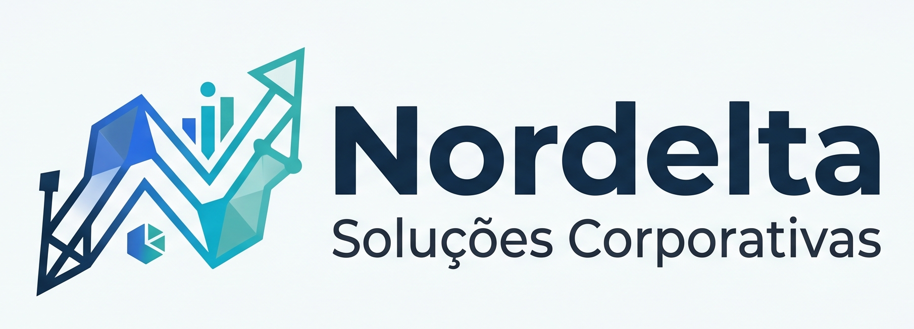
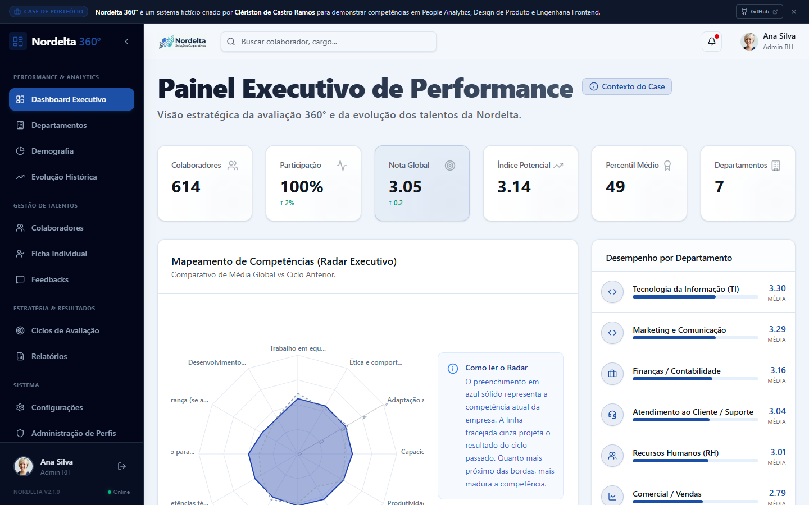
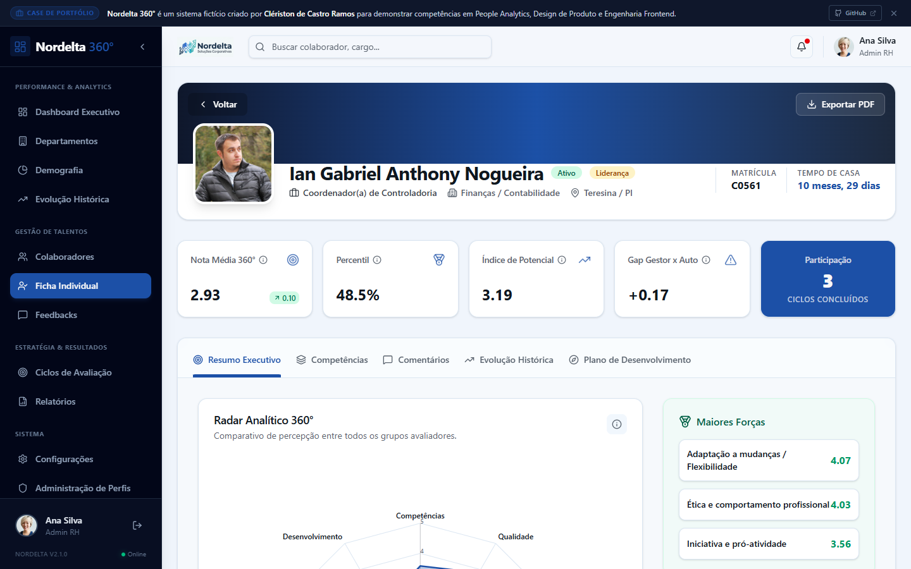
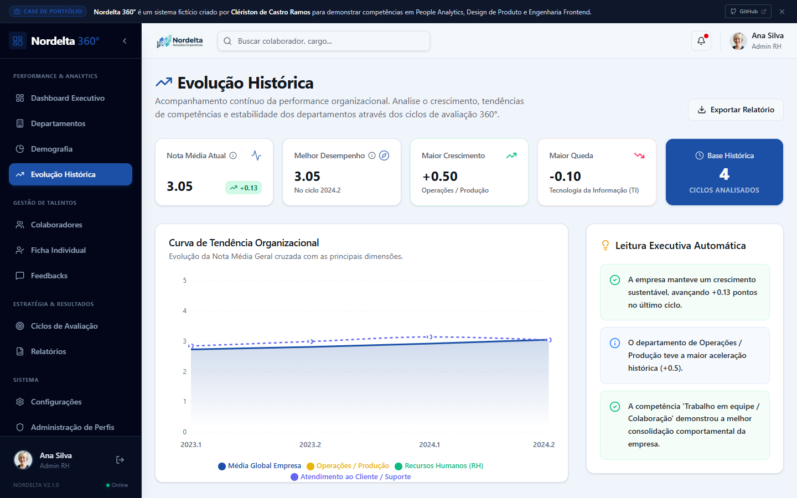
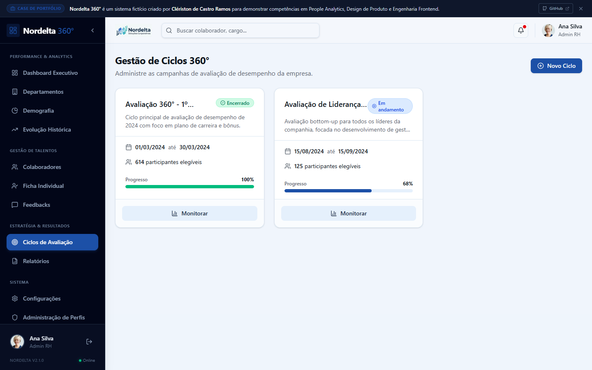
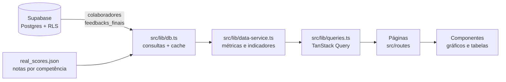

<div align="center">



# Nordelta 360°

**Plataforma de Avaliação de Desempenho 360° e People Analytics**

Dashboard executivo para análise de performance, gaps de percepção entre avaliadores e desenvolvimento de talentos.

[**Ver demonstração ao vivo →**](https://nordelta-360.vercel.app)


[](LICENSE)

</div>

> [!NOTE]
> Projeto fictício desenvolvido como case de portfólio. A "Nordelta Soluções Corporativas", seus colaboradores e todas as avaliações são dados sintéticos.

---

## Sumário

- [Visão geral](#visão-geral)
- [Demonstração](#demonstração)
- [Funcionalidades](#funcionalidades)
- [Stack](#stack)
- [Arquitetura](#arquitetura)
- [Modelo de dados](#modelo-de-dados)
- [Como executar](#como-executar)
- [Scripts](#scripts)
- [Estrutura do projeto](#estrutura-do-projeto)
- [Deploy](#deploy)
- [Roadmap](#roadmap)
- [Autor](#autor)
- [Licença](#licença)

---

## Visão geral

O **Nordelta 360°** simula a área de Gente & Gestão de uma empresa com **614 colaboradores em 7 departamentos**, avaliados em **12 competências** por até **quatro grupos de avaliadores** (gestor, autoavaliação, pares e subordinados).

A partir dessas avaliações, a plataforma responde às perguntas que um RH orientado a dados faz no fim de cada ciclo:

- Quais áreas e competências estão acima ou abaixo da média da empresa?
- Onde a percepção do gestor diverge da autoavaliação do colaborador?
- Quem são os talentos de maior desempenho e potencial?
- Como a performance evoluiu ao longo dos ciclos?
- Qual é o perfil demográfico da força de trabalho?

O foco do projeto é **engenharia front-end, visualização de dados e design de produto** para dashboards B2B de alta densidade de informação.

---

## Demonstração

**Acesse:** [nordelta-360.vercel.app](https://nordelta-360.vercel.app)

O login é apenas de demonstração. As credenciais também aparecem na tela de login, em "Credenciais de acesso".

| E-mail               | Senha      |
| -------------------- | ---------- |
| `rh@nordelta.com.br` | `senha123` |

|                        Dashboard Executivo                         |                       Ficha Individual                        |
| :----------------------------------------------------------------: | :-----------------------------------------------------------: |
|          |  |
|                         **Departamentos**                          |                        **Demografia**                         |
|  |   |
|                       **Evolução Histórica**                       |                    **Ciclos de Avaliação**                    |
|  |           |

---

## Funcionalidades

| Módulo                      | O que oferece                                                                                                                                     |
| --------------------------- | ------------------------------------------------------------------------------------------------------------------------------------------------- |
| **Dashboard Executivo**     | KPIs consolidados, radar de competências (atual × ciclo anterior), heatmap de gaps por departamento, distribuição de notas e ranking de talentos. |
| **Departamentos**           | Comparativo entre áreas com linha de média da empresa, ranking com potencial e gap, radar por área, lista de colaboradores e exportação em PDF.   |
| **Demografia**              | Distribuição por sexo, faixa etária, tempo de empresa, composição dos departamentos e localização (bairros de Teresina/PI e Timon/MA).            |
| **Evolução Histórica**      | Tendência da nota média entre ciclos, evolução por departamento e competência e leitura executiva gerada automaticamente.                         |
| **Colaboradores**           | Diretório com busca, filtros por departamento, cargo, faixa etária e tempo de casa, e ordenação por coluna.                                       |
| **Ficha Individual**        | Radar 360° por grupo de avaliador, forças e pontos de desenvolvimento, gap gestor × auto, percentil, histórico e plano de desenvolvimento.        |
| **Ciclos de Avaliação**     | Criação de ciclos em etapas (wizard) e acompanhamento do progresso de cada rodada.                                                                |
| **Feedbacks e Calibração**  | Matriz de calibração e fila de revisão de feedbacks.                                                                                              |
| **Administração de Perfis** | Usuários, papéis (RBAC), matriz de permissões por módulo e trilha de auditoria.                                                                   |

> Ciclos, Feedbacks, Relatórios e Configurações usam dados simulados no próprio front-end. As demais telas leem os dados do Supabase.

---

## Stack

| Camada           | Tecnologia                                                                                  |
| ---------------- | ------------------------------------------------------------------------------------------- |
| Interface        | [React 19](https://react.dev) + [TypeScript](https://www.typescriptlang.org)                |
| Build            | [Vite 7](https://vite.dev)                                                                  |
| Estilo           | [Tailwind CSS 4](https://tailwindcss.com) + [shadcn/ui](https://ui.shadcn.com) (Radix UI)   |
| Roteamento       | [TanStack Router](https://tanstack.com/router) (rotas por arquivo, com code splitting)      |
| Dados no cliente | [TanStack Query](https://tanstack.com/query) (cache entre páginas)                          |
| Gráficos         | [Recharts](https://recharts.org)                                                            |
| Banco de dados   | [Supabase](https://supabase.com) (Postgres com Row Level Security)                          |
| Exportação       | [jsPDF](https://github.com/parallax/jsPDF) + [html2canvas](https://html2canvas.hertzen.com) |
| Qualidade        | ESLint + Prettier                                                                           |
| Hospedagem       | [Vercel](https://vercel.com)                                                                |

---

## Arquitetura



- **`db.ts`** lê as tabelas uma vez por sessão, converte as matrículas para o formato usado na interface (inicial do cargo + número, ex.: `C0561`) e oferece buscas por matrícula em tempo constante.
- **`data-service.ts`** transforma os dados em indicadores: médias por área e competência, gaps gestor × autoavaliação, percentis, distribuição de notas, rankings e textos de insight.
- **`queries.ts`** centraliza as consultas do TanStack Query. Voltar a uma página reaproveita o cache em vez de recalcular tudo.
- **Code splitting:** cada rota é carregada sob demanda, e as bibliotecas de PDF só são baixadas quando o usuário exporta um relatório.

### Como as notas por avaliador são geradas

O banco guarda a nota consolidada de cada colaborador por competência. As notas por grupo (gestor, auto, pares e subordinados) são derivadas dela por uma função **determinística** (`calculateRaterScores`), baseada em hash da matrícula e da competência. Ela aplica perfis de desempenho, características de cada departamento e padrões de divergência conhecidos (por exemplo, colaborador que se superestima × gestor que vê mais potencial). O resultado é realista, variado e **estável entre recarregamentos**.

---

## Modelo de dados

O schema completo e as políticas de acesso estão em [`supabase/migrations`](supabase/migrations).

| Tabela / view            | Conteúdo                                                                                    |
| ------------------------ | ------------------------------------------------------------------------------------------- |
| `colaboradores`          | Cadastro: cargo, departamento, dados demográficos e endereço.                               |
| `feedbacks_finais`       | Resultado consolidado por colaborador: indicadores, nota média, percentil, gap e potencial. |
| `avaliacoes`             | Avaliações individuais (avaliador × avaliado × competência).                                |
| `avaliacoes_anonimas`    | View das avaliações sem a identidade do avaliador, para preservar o anonimato.              |
| `ciclos_avaliacao`       | Ciclos de avaliação e sua configuração.                                                     |
| `profiles`, `user_roles` | Perfis e papéis (`admin`, `rh`, `gestor`, `colaborador`).                                   |

A leitura pública das tabelas de cadastro e resultados está liberada para a demonstração funcionar sem conta. Escrita e acesso às avaliações individuais ficam restritos aos papéis `admin` e `rh`.

---

## Como executar

**Pré-requisitos:** Node.js 20.12 ou superior e um projeto Supabase com as migrations aplicadas.

```bash
# 1. Clonar
git clone https://github.com/cleristondecastroramos/nordelta-360.git
cd nordelta-360

# 2. Instalar dependências
npm install

# 3. Configurar o ambiente
cp .env.example .env
# edite o .env com a URL e a chave pública (anon) do seu projeto Supabase

# 4. Rodar em desenvolvimento
npm run dev
```

A aplicação abre em [http://localhost:8080](http://localhost:8080).

| Variável                        | Descrição                                        |
| ------------------------------- | ------------------------------------------------ |
| `VITE_SUPABASE_URL`             | URL do projeto Supabase.                         |
| `VITE_SUPABASE_PUBLISHABLE_KEY` | Chave pública (role `anon`) do projeto Supabase. |

> [!IMPORTANT]
> Use somente a chave pública (`anon`). Ela vai no JavaScript do site e é protegida pelas políticas de RLS. Nunca use a `service_role` no front-end.

---

## Scripts

| Comando             | Descrição                                  |
| ------------------- | ------------------------------------------ |
| `npm run dev`       | Servidor de desenvolvimento na porta 8080. |
| `npm run build`     | Build de produção em `dist/`.              |
| `npm run preview`   | Serve o build de produção localmente.      |
| `npm run typecheck` | Verificação de tipos com o TypeScript.     |
| `npm run lint`      | Análise estática com o ESLint.             |
| `npm run format`    | Formatação do código com o Prettier.       |

Scripts de dados (rodar na raiz do projeto):

| Script                               | Descrição                                                                    |
| ------------------------------------ | ---------------------------------------------------------------------------- |
| `node scripts/check-connection.mjs`  | Testa a conexão com o Supabase.                                              |
| `node scripts/disperse-scores.mjs`   | Gera `src/lib/real_scores.json` a partir de `data/evaluations_360.csv`.      |
| `node scripts/update-scores.mjs`     | Recalcula as médias do CSV e grava em `feedbacks_finais` (escreve no banco). |
| `node scripts/update-matriculas.mjs` | Converte as matrículas do banco para o novo formato (escreve no banco).      |

---

## Estrutura do projeto

```
nordelta-360/
├── data/                   # CSVs de origem dos dados sintéticos
├── docs/screenshots/       # Imagens usadas neste README
├── public/                 # Logos e imagens estáticas
├── scripts/                # Scripts de geração e manutenção dos dados
├── src/
│   ├── components/         # Componentes por tela + ui/ (base shadcn/ui)
│   ├── hooks/              # Hooks reutilizáveis
│   ├── integrations/       # Cliente e tipos gerados do Supabase
│   ├── lib/                # Camada de dados, tipos e utilitários
│   ├── routes/             # Páginas (rotas por arquivo do TanStack Router)
│   ├── main.tsx            # Ponto de entrada
│   └── styles.css          # Tema (variáveis oklch) e estilos globais
├── supabase/migrations/    # Schema do banco e políticas de RLS
├── .env.example            # Modelo das variáveis de ambiente
├── .env.production         # Variáveis públicas usadas no build de produção
└── vercel.json             # Rewrite para SPA
```

---

## Deploy

O deploy é feito pela **Vercel**, a cada push na branch `main`.

- O build usa o `.env.production` versionado, que contém apenas a URL e a chave pública do Supabase. Por isso não é preciso cadastrar variáveis no painel da Vercel.
- O `vercel.json` redireciona todas as rotas para o `index.html`, para que o roteamento no navegador funcione ao acessar qualquer URL diretamente.

---

## Roadmap

- [x] Banco de dados relacional com RLS (Supabase)
- [x] Exportação de relatórios em PDF
- [x] Code splitting por rota e cache de consultas
- [ ] Autenticação real com papéis (admin, RH, gestor, colaborador) via Supabase Auth
- [ ] Persistir ciclos, feedbacks e calibração no banco
- [ ] Comentários qualitativos nas avaliações
- [ ] Testes automatizados (unitários para `data-service` e E2E das telas principais)
- [ ] Modelos preditivos de retenção e risco de saída

---

## Autor

**Clériston de Castro Ramos**: planejamento, design de produto, modelagem dos dados sintéticos e engenharia front-end.

[](https://cleristoncramos-portfolio.vercel.app)
[](https://www.linkedin.com/in/cleristonramos)
[](https://github.com/cleristondecastroramos)

---

## Licença

Distribuído sob a licença MIT. Consulte o arquivo [LICENSE](LICENSE) para mais detalhes.
